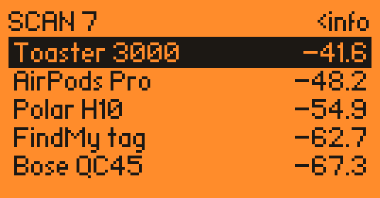
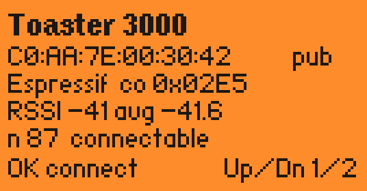
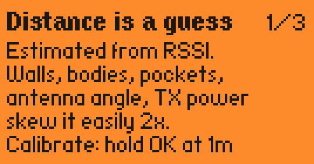
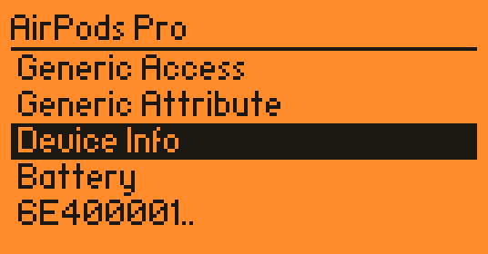
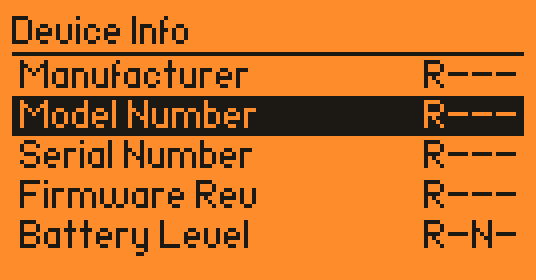
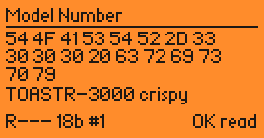
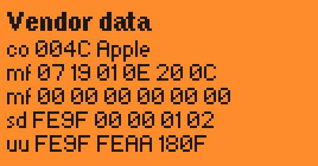

# BLE Scanner for Flipper Zero

Your Flipper has a Bluetooth radio, but out of the box it cannot *see* anything with it.
This fixes that. It scans nearby BLE devices, estimates how far away they are, works out which
of them are AirPods, and lets you explore the internals of the ones that allow a connection.

> **Needs custom firmware.** The app runs only on a Flipper with this repo's patched Momentum build
> **and** ST's full BLE radio stack. On stock firmware, official Momentum, Unleashed and friends the Flipper
> refuses to load it. `build.sh` builds and flashes both, see [Install](#install).

| | | |
|:-:|:-:|:-:|
|  |  |  |
| nearby devices, strongest first | details, connect with OK | built-in help |
|  |  |  |
| services of a connected device | characteristics with R/W/N/I properties | read values and toggle notifications |
|  | | |
| raw manufacturer / service data (Up/Down) | | |

*Screenshots are rendered from the app's own drawing code, using the Flipper's own fonts.
The devices are made up. No toasters were harmed.*

## What it does

- **Scan** (active): every advertiser nearby, sorted by smoothed RSSI, with a distance estimate
- **Name things**: advertised names, plus decoded Apple Continuity data (AirPods/Beats models, Find My
  tags, AirPlay targets, nearby iPhones and Macs), common vendor IDs (Samsung, Google, Bose, Garmin, ...)
  and vendor service UUIDs (Fast Pair, Eddystone, Garmin, MiBeacon, ...)
- **Show vendor data**: Up/Down in the details screen dumps the device's raw manufacturer data, service
  data and advertised 16-bit service UUIDs
- **Connect** to connectable devices (marked `C`) and browse their GATT database: services,
  characteristics with their human names, read values, and subscribe to notifications **and**
  indications (confirmed on the app thread, they block the server otherwise)
- **Dump** a service: hold OK on its characteristics to read every readable characteristic, one at a
  time, and save them with their names to `/ext/apps_data/ble_scanner/gatt.log`
- **Log** a snapshot every 2 s to `/ext/apps_data/ble_scanner/scan.log` while on USB power (on battery it
  skips the SD writes): `storage read /ext/apps_data/ble_scanner/scan.log` in the Flipper CLI

Distance is a guess, not a tape measure. It comes from the RSSI through a log-distance path-loss model,
and walls, bodies and pockets can easily skew it by 2x. Calibrate it (see below) and treat it as
"close / not close".

## Why a custom firmware?

The Flipper's Bluetooth runs on a second core inside its STM32WB55 chip, using ST's radio stack.
The stock stack is ST's **light** version, which is peripheral only. In ST's own words it "is not able to scan".
No app can get around this, so this project:

1. swaps the radio for ST's **full** BLE stack (it fits, with about 5 KB of flash to spare)
2. patches [Momentum](https://github.com/Next-Flip/Momentum-Firmware) with a few small exports so apps can
   scan and send raw HCI commands (`patches/momentum-ble-scan.patch`)

## Heads up

- You flash a new radio stack **and** a self-built firmware. It uses the regular update mechanism and is
  recoverable (qFlipper repair, or just install official Momentum again), but you do it at your own risk.
- Pinned to Momentum dev `d3f89dfe`. Other versions will likely need the patch rebased.
- An official Momentum update replaces the patched firmware and puts the light stack back. The app won't load
  until you flash this build again. (On the patched firmware with the light stack it shows "No BLE scan support".)
- Momentum features that rely on the light stack's "additional beacon" (e.g. BLE spam) may not work on the full stack.
- Only connect to devices you own. Reading other people's gadgets is rude at best.

## Install

You need a Flipper Zero on USB, macOS or Linux, `git`, `python3` and `dfu-util`. Close qFlipper,
as it takes over the serial port.

```sh
./build.sh             # fetch Momentum, apply the patch, build firmware + radio package + app
./build.sh flash-fw    # first time only: installs the full radio stack (and firmware) via the updater
./build.sh flash-dfu   # writes the firmware directly over USB DFU, no SD card needed
./build.sh flash-app   # installs the app to Apps > Bluetooth and starts it
```

The first build downloads Flipper's toolchain and takes a few minutes.

**Recommended path:** run `flash-fw` once to get the full radio stack. On our test unit the updater often
could not mount its (old) SD card, which shows up as "Waiting for SD card" or "Manifest pointer error". If
that happens, hold Back to cancel, check `info device` in the CLI for `radio.stack.type: 1` (full stack), and
install the firmware with `flash-dfu` instead. Every later firmware change can go through `flash-dfu`.

## Controls

| Screen | Keys |
|---|---|
| **List** | Up/Down select, OK details, Left for info screen (3 pages), Back exit |
| **Details** | OK connect (only devices marked `C`), Up/Down summary / vendor data, Left/Right for 1 m reference ±1 dB, hold OK to calibrate the 1 m reference from this device |
| **Services** | Up/Down select, OK for characteristics, Back to disconnect |
| **Characteristics** | Up/Down select, OK to open value, hold OK to dump the service to `gatt.log`, Back to go up one level |
| **Value** | OK to read, Right to toggle notifications/indications (offered once its CCCD is found), Back to go up one level |

Calibrating: hold a device 1 m away, open its details and hold OK. Its smoothed RSSI becomes the 1 m reference.

Flags: `C` connectable, `R` answered an active scan request (in the log), properties `R`ead `W`rite
`N`otify `I`ndicate.

## Nerd corner

- **Flash budget**: the full stack v1.20 installs at `0x080CE000`, the patched firmware ends just below
  `0x080CD000`. The bundler's layout check refuses to build a package if they ever overlap.
- **Option bytes**: Momentum's `scripts/ob.data` expects the light stack's secure flash/SRAM layout, and the
  updater reports the full stack's values as an "Uncorr. value mismatch". `ob_full.data` carries the full
  stack's values (`SFSA 0xCE, SBRV 0x33800, SBRSA 0xA, SNBRSA 0xF`) and `build.sh` uses it.
- **Firmware patch** (API 87.1 → 87.2): GAP init adds the observer and central roles on the full stack, plus
  three exports: `furi_hal_bt_start_scan`, `furi_hal_bt_stop_scan` and `furi_hal_bt_hci_command` (raw HCI/ACI).
- **App**: receives raw HCI events through the already exported `ble_event_dispatcher_register_svc_handler`.
  It only claims events of its own central link, so your phone's connection to the Flipper keeps working.
  Notifications are switched on through the CCCD found by a descriptor search, never a guessed handle.
- **Descriptors**: the same search finds each characteristic's `0x2901` user description, which the value
  screen shows as its title instead of a vendor UUID. Indications get `aci_gatt_confirm_indication` from the
  main loop, since the BLE event thread cannot wait for an HCI command event.
- **Errors**: ATT errors and disconnect reasons are printed with their spec names (`need pair`,
  `peer left`, ...) instead of a bare code.
- **Screenshots**: `tools/screenshots/render.sh` compiles the app's view code with Momentum's u8g2 and fonts
  on your computer and writes `docs/*.png`.
- **Adv parsing check**: `tools/adv_test.c` is a host-side assert test for the advertisement parser and
  vendor labels, see the compile line in its header.

## Undo

Install official Momentum with qFlipper or the [web updater](https://momentum-fw.dev/update).
It reinstalls the light radio stack and returns you to stock.

## Credits

- [Momentum firmware](https://github.com/Next-Flip/Momentum-Firmware), which this patches and builds on
- ST's STM32WB wireless stacks, shipped with Momentum
- AirPods/Beats model IDs from Momentum's BLE spam app
- [u8g2](https://github.com/olikraus/u8g2) fonts for the screenshots

Built with an AI coding assistant. Momentum does not accept AI-generated contributions, so this patch
lives here and is not meant to be upstreamed. Not affiliated with Flipper Devices or the Momentum team.

## License

GPL-3.0, like the Momentum firmware the patch is derived from. See [LICENSE](LICENSE).
